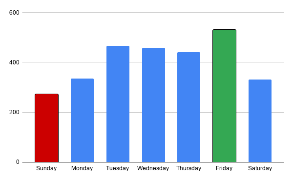

# Case Study: Facility Attendance & Capacity Optimization
**Author:** Steve Carr | Operations & Logistics Specialist  
**Tools Used:** Microsoft Excel (Pivot Tables, Advanced Formulas, Cross-Sheet References), Data Hygiene & Quality Auditing

---

## Executive Summary
This project analyzes 218 active days of client attendance data (2,835 total client visits) from November 2025 through June 2026 to evaluate facility utilization, optimize staff scheduling, and identify operational data collection gaps.

---

## Key Operational Findings

- **Mid-Week & Friday Traffic Spikes:** Friday is the highest-volume operational day, averaging **17.1 clients/day** (peak of 23), followed by Tuesday (**15.1/day**) and Wednesday (**14.8/day**). Friday experiences a **94% increase in traffic** compared to Sunday.
- **Weekend / Monday Lulls:** Sunday represents the lowest facility utilization at **8.8 clients/day** (dipping as low as 3). Mondays (**10.5/day**) and Saturdays (**10.7/day**) present opportunities for scheduled maintenance or reduced staffing overhead.
- **Data Integrity Audit:** Identified manual logging inconsistencies on weekend shifts (Saturday records relied on secondary staff estimates ranging from 6 to 12).

---

## Strategic Recommendations

1. **Labor Reallocation:** Reallocate floor hours and shift coverage from low-demand periods (Sunday/Monday) to peak operational windows (Tuesday–Friday) to prevent bottlenecking and reduce unnecessary staff overhead.
2. **Process Automation:** Replace manual paper/tally count sheets with a digital check-in system or automated tablet log to eliminate unrecorded client visits on unstaffed/partially staffed weekend days.

# Corporate FP&A Case Study: Labor Optimization & Operational P&L Model

## Executive Summary
This project analyzes operational attendance, labor costs, and revenue performance across an 8-month period (Nov 2025 – Jun 2026) for the "Camp" department. By developing a dynamic P&L and labor variance model, this analysis identified key profit leakage on low-attendance days and modeled actionable scheduling adjustments that restored operating margins and captured **$19,448 in annualized bottom-line savings**.

---

## Model Assumptions & Key Parameters
- **Revenue Model:** $75.00 per client session
- **Hourly Labor Wage:** $22.00/hour flat staff rate
- **Tracked Portfolio Horizon:** 8 Months (Nov 2025 – Jun 2026) | $212,625 Total Gross Revenue | $76,224.50 Total Payroll Cost
- **Baseline Labor Ratio:** 35.9% overall labor-to-revenue cost

---

## Operational Baseline & Profit Leakage Breakdown

| Day of Week | Avg Attendance | Daily Revenue | Labor Hours | Daily Labor Cost | Daily Net Profit | Labor % of Revenue | Operational Status |
| :--- | :---: | :---: | :---: | :---: | :---: | :---: | :--- |
| **Sunday** | 8.77 | $658.06 | 5.25 hrs | $115.50 | $542.56 | 17.6% | Lean / Efficient |
| **Monday** | 10.50 | $787.50 | 8.25 hrs | $181.50 | $606.00 | 23.0% | Lean / Efficient |
| **Tuesday** | 15.06 | $1,129.84 | 25.00 hrs | $550.00 | $579.84 | **48.7%** | ⚠️ Profit Leakage (3-Person Shift) |
| **Wednesday** | 14.81 | $1,110.48 | 16.50 hrs | $363.00 | $747.48 | **32.7%** | 🎯 Efficient Benchmark (2-Person Shift) |
| **Thursday** | 14.19 | $1,064.52 | 25.00 hrs | $550.00 | $514.52 | **51.7%** | ⚠️ Profit Leakage (3-Person Shift) |
| **Friday** | 17.10 | $1,282.26 | 25.00 hrs | $550.00 | $732.26 | 42.9% | Peak Attendance Shift |
| **Saturday** | 10.68 | $800.81 | 6.50 hrs | $143.00 | $657.81 | 17.9% | Lean / Efficient |
| **WEEKLY TOTAL** | **91.11 / wk** | **$6,833.47** | **111.50 hrs** | **$2,453.00** | **$4,380.47** | **35.9%** | Baseline Target |

---

## Key Financial Insights & Variance Analysis

1. **Tuesday & Thursday Profit Leakage:**
   - Static 3-person staffing (25 hours / $550 payroll per day) on Tuesdays and Thursdays created significant margin compression when client attendance averaged ~14–15 clients.
   - Payroll consumed **48.7% to 51.7%** of top-line daily revenue on those days.
2. **Wednesday Efficiency Benchmark:**
   - Operating with a 2-person team (16.5 labor hours / $363 payroll) supported 14.8 clients while generating the highest daily profit (**$747.48**) at a lean **32.7% labor ratio**.

---

## Management Action & Financial Impact

- **Operational Decision:** Management removed the redundant 3rd staff member (8.5 hrs / $187 cost) on Tuesdays and Thursdays, aligning shift capacity with actual client volume.
- **Cost Reduction:** Direct payroll savings of **$374.00 per week**.
- **Bottom-Line Impact:** Captured **$19,448.00 in annual recurring savings**.
- **Margin Optimization:**
  - Tuesday Labor Ratio improved from **48.7% → 32.1%**.
  - Thursday Labor Ratio improved from **51.7% → 34.1%**.
  - Department Overall Labor Ratio improved from **35.9% → 30.4%**.

---

## Sensitivity Analysis: Downside Stress Test (-33.3% Volume Drop)

To evaluate operational downside risk, a stress test was conducted modeling a **1/3 reduction in client attendance** under fixed labor conditions:
- **Revenue Reduction:** Weekly revenue drops from $6,833.47 to **$4,555.65** (-33.3%).
- **Bottom-Line Impact:** Fixed labor ($2,453/wk) causes net profit to collapse by **52.0%** (from $4,380.47 to $2,102.65).
- **Labor Overhead Spike:** Department labor ratio spikes to **53.8%**, pushing Thursday labor costs to **77.5% of daily revenue**.
- **Strategic Takeaway:** Proves the necessity of dynamic, attendance-driven scheduling over rigid shift structures during seasonal or demand-driven downturns.

